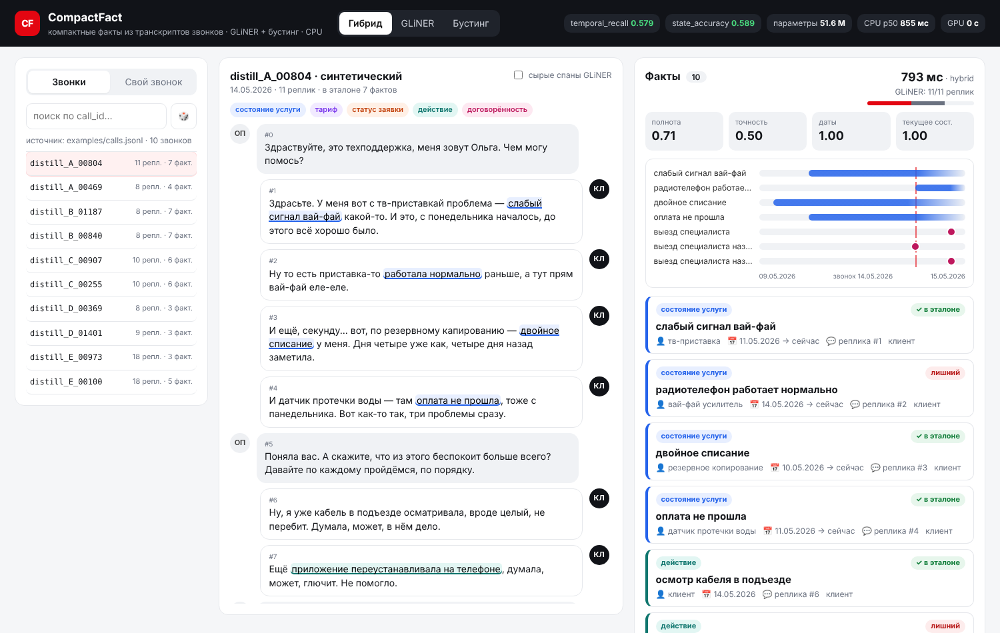
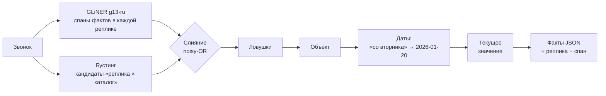
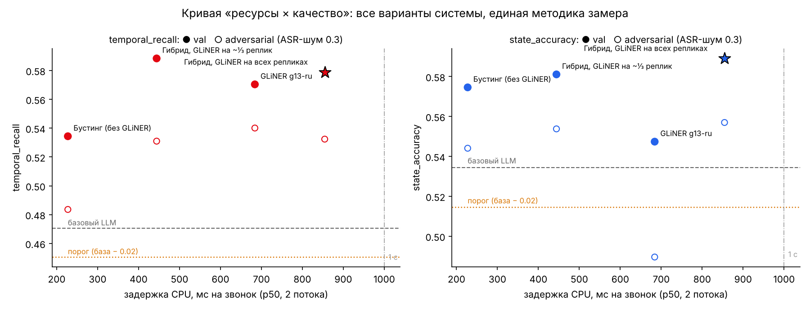
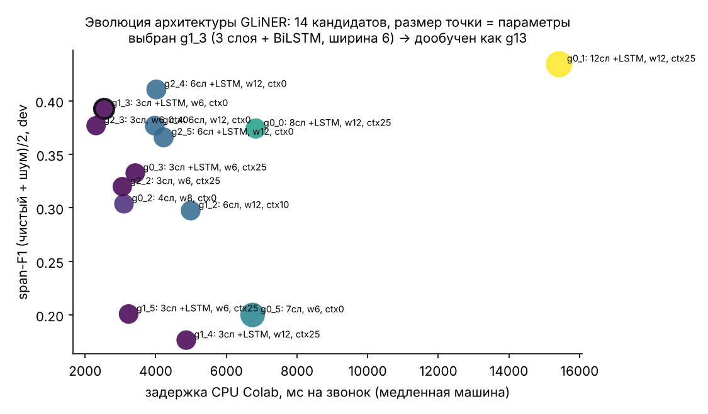

<div align="center">

# CompactFact

**Компактные факты из шумных транскриптов звонков: GLiNER + бустинг, только CPU**

Кейс МТС MWS «CompactFactExtraction» · Innopolis Global Hack 2026




</div>

## Главное

| | базовый LLM-экстрактор | **CompactFact** | допустимый минимум (база − 0.02) |
|---|---|---|---|
| **temporal_recall** (val) | 0.471 | **0.579** (+0.108) | 0.451 |
| **state_accuracy** (val) | 0.535 | **0.589** (+0.054) | 0.515 |
| temporal / state, adversarial (ASR-шум 0.3) | — | **0.532 / 0.557** | — |
| корректность схемы | — | **383 / 383 звонков** | 100 % |
| параметры | ≈744 млрд (семейство GLM-5) | **51.5 млн** (в ~14 000 раз меньше) | сокращение ≥ 10× |
| GPU-секунд на звонок | GPU | **0** | сокращение ≥ 5× |
| задержка CPU, p50 | — | **855 мс** (2 потока, сервер) · 263 мс (Mac M-серии) | ~1 с |

Метрики посчитаны официальным `case_metrics.py` v2.1 сквозным прогоном конвейера (`src/evaluate.py`).
Все варианты системы, кривая «ресурсы × качество» и методика замеров — в [`reports/RESULTS.md`](reports/RESULTS.md).

## Запуск одной командой

```bash
git clone https://github.com/xqzme-otec/MWS_hack.git && cd MWS_hack
docker compose up --build          # → http://localhost:8000
```

Модели уже лежат в репозитории (`models/`), скачивать ничего не нужно.
Чтобы в интерфейсе были звонки из val с эталоном, положите `val.jsonl` из пакета кейса в `data/`.
Без него показываются 10 синтетических звонков из `examples/`.

| команда | что делает |
|---|---|
| `docker compose up --build` | веб-интерфейс и API на :8000 |
| `docker compose --profile eval run --rm eval` | метрики на val и adversarial, разбор ошибок, замер ресурсов, графики → `reports/` |
| `docker compose --profile train run --rm train` | **обучение с нуля**: бустинг → GLiNER → урезание словаря → оценка |
| `docker compose --profile train-gpu run --rm train-gpu` | то же на NVIDIA GPU |
| `docker compose --profile train run --rm -e SMOKE=1 train` | смоук-тест всего конвейера обучения за ~10 минут |

Для обучения и оценки нужны `data/train.jsonl` и `data/val.jsonl` из пакета кейса. Данные кейса мы не публикуем.

<details><summary>Без Docker</summary>

```bash
python3.13 -m venv .venv && source .venv/bin/activate
pip install torch==2.15.0 --index-url https://download.pytorch.org/whl/cpu && pip install -r requirements.txt
uvicorn --app-dir src api:app --port 8000      # сервис
python src/evaluate.py --sets val,val_adv       # метрики
bash scripts/reproduce.sh                       # обучение с нуля
```
</details>

## Как это работает



1. **GLiNER — основная модель.** Это NER-модель, которая находит в каждой реплике фразы-факты пяти типов, а также объекты и даты.
   Основа — `knowledgator/gliner-x-small` (энкодер mT5). Архитектуру мы подобрали **эволюцией** (14 кандидатов):
   - из 8 слоёв энкодера оставили **3**;
   - сохранили BiLSTM;
   - ширина спана — 6 слов;
   - контекст соседних реплик не подаём.

   Затем дообучили модель на разметке, восстановленной из train.
2. **Урезанный словарь.** Убрали из словаря mT5 токены чужих языков: 250 тыс. → 37.6 тыс. токенов, 160 → **51.5 млн** параметров.
   Предсказания при этом не изменились ни на одной реплике val.
3. **Бустинг** — градиентный бустинг по признакам «реплика × значение каталога». Он добавляет факты там, где GLiNER промолчал, и поднимает полноту.
4. **Сборка.** Ловушки отсекают вопросы, отказы и догадки оператора. Дальше выбирается объект. Относительные даты переводятся в абсолютные.
   Из цепочек состояний вычисляется текущее значение: «принята» → «в работе» закрывает интервал.
   Около 40 порогов сборки подобраны генетическим алгоритмом на golden-наборе из train; val в подборе не участвует.

Подробнее: [`docs/ARCHITECTURE.md`](docs/ARCHITECTURE.md), путь экспериментов — [`docs/EXPERIMENTS.md`](docs/EXPERIMENTS.md).

## Кривая «ресурсы × качество»

Мы показываем не одну лучшую точку, а все варианты системы, замеренные по единой методике:
одни и те же звонки, отдельный процесс на вариант, 2 потока CPU, p50 и p95, пиковая память (`src/bench_resources.py`).



| вариант | temporal val / adv | state val / adv | полнота | p50 / p95 CPU | память | параметры |
|---|---|---|---|---|---|---|
| Бустинг (без GLiNER) | 0.534 / 0.484 | 0.575 / 0.544 | 0.414 | 227 / 628 мс | 789 МБ | 0.05 M |
| GLiNER g13-ru | 0.570 / 0.540 | 0.547 / 0.490 | 0.340 | 684 / 2362 мс | 1397 МБ | 51.6 M |
| Гибрид, GLiNER на ~⅓ реплик | 0.588 / 0.531 | 0.581 / 0.554 | 0.414 | 444 / 1142 мс | 1408 МБ | 51.6 M |
| Гибрид, GLiNER на всех репликах ★ | 0.579 / 0.532 | 0.589 / 0.557 | 0.435 | 855 / 2605 мс | 1433 МБ | 51.6 M |
| Гибрид, полный словарь mT5 (160M) | 0.579 / 0.532 | 0.589 / 0.557 | 0.435 | 829 / 2654 мс | 2326 МБ | 160.37 M |
| базовый LLM-экстрактор | 0.471 / — | 0.534 / — | 0.381 | GPU | — | ≈744 000 M |

Выводы из кривой:
- **Гибрид лучше обоих компонентов.** Только GLiNER точнее, но теряет полноту и не держит state_accuracy под шумом (0.490). Бустинг быстрый, но теряет temporal_recall под шумом (0.484).
- **Префильтр реплик** вдвое сокращает время при том же качестве (разница в пределах шума ±0.025). Команда выбрала режим, где GLiNER видит каждую реплику.
- **Урезание словаря** не меняет качество и скорость, но память падает с 2.3 до 1.4 ГБ, а веса — с 628 до 114 МБ.

Эволюция архитектуры GLiNER: 14 кандидатов, размер точки — число параметров.



## Устойчивость и ошибки

- **Adversarial-подмножество** (`src/make_adversarial.py`, детерминированное). Это val с усиленным ASR-шумом:
  - замены букв по матрице путаниц ASR, выученной на train;
  - выпадение слов;
  - слова-паразиты;
  - нижний регистр без пунктуации.

  Temporal_recall **0.532**, state_accuracy **0.557** — обе метрики выше допустимого минимума.
- **Разбор ошибок по типам фактов** — [`reports/error_analysis.md`](reports/error_analysis.md):
  P, R, F1, даты и текущее состояние по каждому атрибуту; причины пропусков и лишних фактов с примерами; сравнение с базовым LLM и с adversarial.

Главное из разбора ошибок:
- **Сильнее базового LLM** на `action` (F1 0.49 против 0.15), `service_state` (0.37 против 0.19) и `agreement` (0.35 против 0.19). Это длинные формулировки, и спан-модель находит их прямо в тексте.
- **Слабее базового LLM** на `tariff` (F1 0.55 против 0.75) и `ticket_status` (0.65 против 0.74): здесь нужно выбрать одно значение из каталога по всему звонку, и большая модель с ним справляется лучше. При этом текущее состояние заявки мы определяем точнее (0.88 против 0.76).
- **Причины пропусков** (1042 эталонных факта без пары):
  - факт этого типа найден, но в другом месте звонка — 40%;
  - факт этого типа вообще не найден — 29%, чаще всего `agreement` и `action`;
  - в нужной реплике выбрано не то значение — 28%.
- **Лишние факты** (850):
  - 59% — упоминания, которых нет в эталоне рядом;
  - 41% — дубли или другие формулировки эталонного факта.
- **Под ASR-шумом** F1 по атрибутам падает не больше чем на 0.04.

## API

```bash
curl -X POST localhost:8000/extract -H 'Content-Type: application/json' -d '{
  "call_id": "c1", "started_at": "2026-01-21T10:00:00",
  "turns": [{"speaker": "client", "text": "со вторника интернет пропадает каждый вечер"},
            {"speaker": "operator", "text": "заявка 4055 уже в работе, мастер приедет послезавтра"}]}'
```

Ответ — звонок с полем `facts` в схеме кейса, плюс `source.span` и `meta.latency_ms`.
Параметры запроса:
- `?mode=gliner|boosting|hybrid` — переключение движка;
- `?debug=1` — сырые спаны GLiNER.

Документация Swagger — `/docs`.

## Воспроизводимость

- `scripts/reproduce.sh` — полный путь от данных до метрик. Гиперпараметры лежат в `configs/`, seed 42.
- Расписание обучения GLiNER фиксировано в шагах (`--total_steps 14634`), поэтому не зависит от скорости машины.
- Время обучения GLiNER: ≈ 30 мин на T4 или Apple M-серии; на CPU — несколько часов. Нужно ≥ 12 ГБ RAM.
- `EVOLVE=1` дополнительно заново подбирает гены сборки эволюцией.
- Веса в репозитории хранятся тремя частями меньше 50 МБ. При сборке они склеиваются, контрольная сумма проверяется.

## Структура

```
src/cfx/pipeline.py      финальный конвейер (API, веб, оценка и замеры используют его)
src/api.py, web/         HTTP API и веб-интерфейс
src/evaluate.py          сквозная оценка официальным case_metrics.py
src/bench_resources.py   замер ресурсов по единой методике
src/error_report.py      разбор ошибок по типам фактов
src/train_gliner_gpu.py  дообучение GLiNER (CUDA / MPS / CPU), урезание слоёв
src/prune_vocab.py       урезание словаря mT5 до русского
src/run_evolve_gcore.py  эволюция генов сборки
src/synth/               дистилляция через DeepSeek (adversarial-синтетика)
models/                  g13_ru (GLiNER), compactfact_v5.pkl (бустинг), гены
reports/                 метрики, графики, разбор ошибок, замеры
docs/                    архитектура, эксперименты, идеи
```

## Идеи развития

Self-training на реальных звонках, проверка спорных фактов крупной моделью, новые атрибуты через метки GLiNER, многоязычность — [`docs/IDEAS.md`](docs/IDEAS.md).
