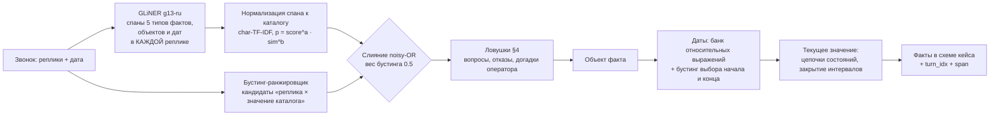

# Архитектура CompactFact

## Задача

Звонок в поддержку — 10–100 реплик, по которым прошёлся ASR: «в рабате», «пиресчёт», «Всё для зова».
Нужно извлечь компактные факты по схеме кейса (`data/schema.md`):

| атрибут | что это | темпоральный |
|---|---|---|
| `service_state` | состояние услуги («периодические обрывы», «не работает») | да, меняется во времени |
| `tariff` | тарифный план | да |
| `ticket_status` | статус заявки («принята» → «в работе») | да |
| `agreement` | договорённость (выезд, перезвон, срок) | да (срок) |
| `action` | действие клиента или оператора | нет |

У каждого факта есть объект, полярность, `valid_from` и `valid_to`, а также реплика-источник с позицией фразы в тексте.
Даты звучат относительно: «со вторника», «через неделю после двух». Их нужно привести к абсолютным датам от `started_at`.

## Конвейер

**1. GLiNER — основная модель.** Это NER-модель, которая ищет спаны по названию метки. Метки: 5 типов фактов, объект и дата.
Энкодер — mT5-small из `knowledgator/gliner-x-small`, с архитектурой, найденной эволюцией:

- из 8 слоёв энкодера оставлено **3**;
- над энкодером оставлен BiLSTM;
- максимальная ширина спана — 6 слов;
- контекст следующей реплики не подаётся.

Модель дообучена на разметке, которую мы восстановили из эталонных фактов train: 24 220 примеров, 3 эпохи с фиксированным расписанием, seed 42.
GLiNER проходит по **всем** репликам звонка. Префильтр реплик существует, но выключен: так решила команда.

**2. Урезание словаря.** У mT5 словарь на 250 тыс. токенов почти на всех языках мира, и на него приходится 128 млн из 160 млн параметров.
Мы оставили 37.6 тыс. токенов:

- кириллица;
- символы и цифры;
- латиница, которая встречается в корпусе;
- короткие латинские токены.

Токенизация всех 9 346 реплик val при этом не изменилась ни в одном случае, предсказания совпадают (разница вероятностей ≤ 0.002).
Итог — **51.5 млн параметров** и 103 МБ весов (fp16 при хранении, вычисления в fp32). Скрипт — `src/prune_vocab.py`.

**3. Бустинг — помощник по полноте.** Это градиентный бустинг (HistGradientBoosting) по признакам реплики и значения каталога.
Он обучен с cross-fitting на train. Его кандидаты сливаются с кандидатами GLiNER по формуле noisy-OR с весом 0.5 и порогом 0.126.
Бустинг добавляет факты там, где GLiNER промолчал. Если отключить бустинг, полнота падает с 0.435 до 0.340, а state_accuracy на adversarial — с 0.557 до 0.490 (см. `reports/RESULTS.md`).

**4. Сборка** — общая для всех вариантов. Каждый шаг отдельно обучен или подобран эволюцией:

- **Ловушки.** Отсекаются вопросы, гипотезы, догадки оператора, которые клиент отверг, и цитаты чужих слов.
- **Объект.** Клиент, услуга, устройство или заявка; выбирается моделью `ObjectChooser`.
- **Даты.** Банк относительных выражений повторяет восстановитель оценщика: «со вторника», «послезавтра», «через неделю после двух».
  Затем бустинг выбирает, какая дата — начало, а какая — конец.
- **Текущее значение.** Цепочки «принята → в работе» закрываются; на пару (объект, атрибут) остаётся одно открытое значение.
- **Позиция фразы (`source.span`).** Берутся символьные оффсеты спана GLiNER внутри реплики. Метрика `grounding_span` = 0.935.

## Почему GLiNER, а не LLM

- **Генеративная LLM на CPU не укладывается во время.** Qwen3-0.6B в few-shot тратила 112 с на звонок и не выдала разбираемый JSON (`docs/EXPERIMENTS.md`).
  Базовый экстрактор кейса — LLM уровня GLM-5 с сотнями миллиардов параметров.
- **Извлечение здесь — это поиск фраз в тексте.** Почти все значения фактов — цитаты или их нормализация к каталогу.
  Спан-модель решает такую задачу напрямую, сразу даёт позицию фразы (`grounding_span`) и не может выдать невалидный JSON.
- **GLiNER ищет сущности по названию метки.** Новый тип атрибута — это новая метка, а не новая голова классификатора (`docs/IDEAS.md`).

## Почему гибрид

GLiNER точнее бустинга (P 0.536 против 0.513), бустинг полнее (R 0.414 против 0.340).
Сквозные прогоны на val (`reports/RESULTS.md`):

| вариант | T val / adv | S val / adv |
|---|---|---|
| только бустинг | 0.534 / 0.484 | 0.575 / 0.544 |
| только GLiNER | 0.570 / 0.540 | 0.547 / 0.490 |
| **гибрид** | **0.579 / 0.532** | **0.589 / 0.557** |

У каждого компонента по отдельности есть слабое место под шумом: у бустинга это даты, у GLiNER — текущее состояние. Гибрид держит обе метрики.

## Где какой код

| файл | что делает |
|---|---|
| `src/cfx/pipeline.py` | финальный конвейер: загрузка моделей, инференс, спаны, проверка схемы, замер времени |
| `src/cfx/gliner_fusion.py` | GLiNER: тексты реплик → спаны с оффсетами |
| `src/cfx/gliner_core.py` | спаны GLiNER → кандидаты фактов (нормализация к каталогу, пороги) |
| `src/cfx/extractor.py` | бустинг-ранжировщик и общая сборка фактов (`assemble`) |
| `src/cfx/dates.py`, `dates_bank.py` | относительные даты → абсолютные |
| `src/cfx/objects.py`, `current.py`, `state.py` | объекты, текущее значение, цепочки состояний |
| `src/cfx/evolve.py` | генетический поиск генов сборки (пороги, режимы, веса слияния) |
| `src/train_gliner_gpu.py` | дообучение GLiNER (CUDA / MPS / CPU), урезание слоёв, фиксированное расписание |
| `src/prune_vocab.py` | урезание словаря mT5 до русского |
| `src/api.py`, `web/` | HTTP API и веб-интерфейс |
