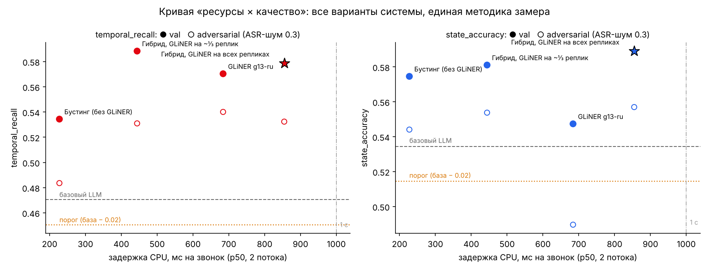
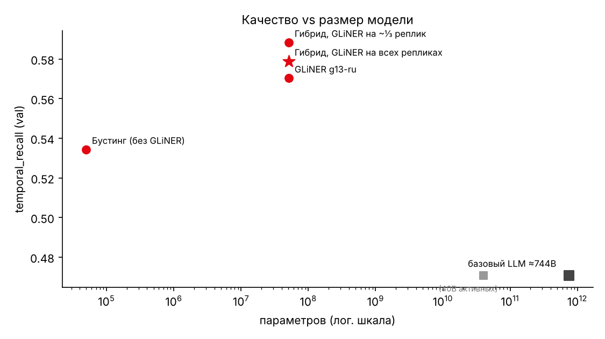
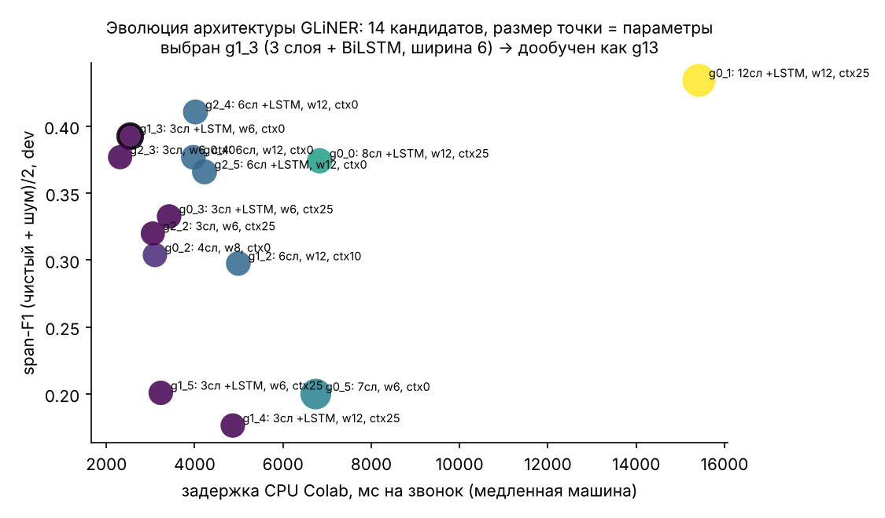

# Результаты

Машина замеров: Intel(R) Xeon(R) Processor @ 2.10GHz, 2 ядер; 2 потока torch; GPU не используется.

## Критерий 1: качество против базового LLM-экстрактора

| | temporal_recall | state_accuracy |
|---|---|---|
| базовый LLM-экстрактор (`baseline_pred.jsonl`) | 0.471 | 0.534 |
| допустимый минимум (база − 0.02) | 0.451 | 0.514 |
| **CompactFact (гибрид)** | **0.579** (+0.108) | **0.589** (+0.055) |

## Все варианты системы (кривая «ресурсы × качество»)

| вариант | T val | S val | T adv | S adv | P | R | реплика | спан | схема | p50 мс | p95 мс | RSS МБ | параметры | диск МБ | GPU-с |
|---|---|---|---|---|---|---|---|---|---|---|---|---|---|---|---|
| Бустинг (без GLiNER) | 0.534 | 0.575 | 0.484 | 0.544 | 0.513 | 0.414 | 0.800 | 0.970 | 383/383 | 227 | 628 | 789 | 0.05 M | 16 | 0 |
| GLiNER g13-ru | 0.570 | 0.547 | 0.540 | 0.490 | 0.536 | 0.340 | 0.662 | 0.954 | 383/383 | 684 | 2362 | 1397 | 51.6 M | 114 | 0 |
| Гибрид, GLiNER на ~⅓ реплик | 0.588 | 0.581 | 0.531 | 0.554 | 0.536 | 0.414 | 0.751 | 0.935 | 383/383 | 444 | 1142 | 1408 | 51.6 M | 114 | 0 |
| Гибрид, GLiNER на всех репликах ★ | 0.579 | 0.589 | 0.532 | 0.557 | 0.486 | 0.435 | 0.725 | 0.935 | 383/383 | 855 | 2605 | 1433 | 51.6 M | 114 | 0 |
| Гибрид, полный словарь mT5 (160M) | 0.579 | 0.589 | 0.532 | 0.557 | 0.486 | 0.435 | 0.725 | 0.935 | 383/383 | 829 | 2654 | 2326 | 160.37 M | 628 | 0 |
| базовый LLM-экстрактор | 0.471 | 0.534 | — | — | 0.335 | 0.381 | 0.783 | — | — | — | — | — | ≈744 000 M¹ | — | GPU |

¹ семейство GLM-5: 744B параметров, 40B активных (публичные данные).

